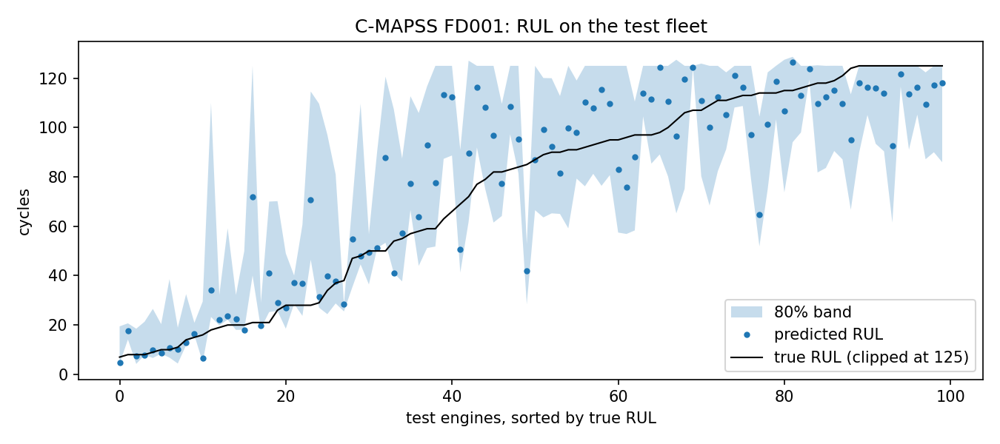
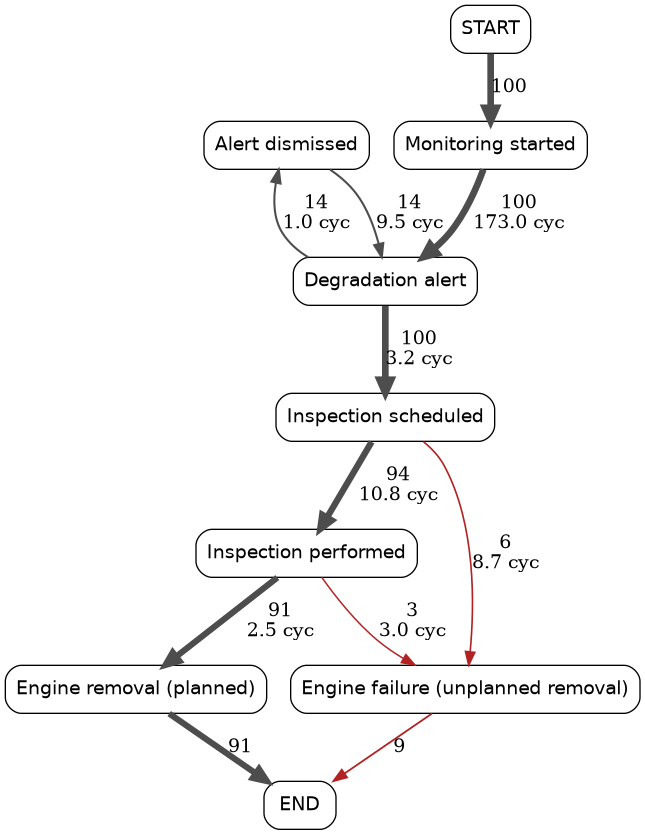

# xpdm: explainable predictive maintenance

[](https://github.com/profrenansantos/xpdm-example/actions/workflows/ci.yml)  

Predicting when a turbofan engine will fail is only half of a maintenance decision. Someone still has to decide which engine to inspect first and defend that choice. This repository runs the whole chain on NASA's C-MAPSS turbofan data:

1. **Remaining useful life (RUL)** from sensor trajectories, with an 80% uncertainty band (gradient boosting with quantile models; cross-validation grouped by engine).
2. **Process mining** on a maintenance event log produced by replaying those predictions through a condition-based maintenance policy: directly-follows graph, variants, and conformance against the intended process.
3. **Multicriteria ranking** of the in-service fleet with TOPSIS, where each engine's position decomposes into per-criterion contributions, with a weight-sensitivity check.
4. **Explanations** an engineer can verify: a template rationale for every ranked engine that uses only numbers from the table, the sensors furthest from the healthy baseline, and an optional language-model summary checked for numbers the table does not contain.



## Results on FD001

| | |
|---|---|
| Cross-validated RMSE, training engines (RUL clipped at 125) | 16.3 cycles |
| Test RMSE, 100 in-service engines (clipped / unclipped) | 17.4 / 18.3 cycles |
| PHM08 score, test | 866 |
| Coverage of the nominal 80% band, test | 76% |
| Truly urgent engines (true RUL ≤ 30) in the top 10: TOPSIS with rank-order weights | 9 / 10 |
| Same, TOPSIS with data-driven CRITIC weights | 8 / 10 |
| Same, sorting by predicted RUL only | 10 / 10 |

The RMSE is a typical result for gradient boosting on FD001; published deep sequence models (CNN, LSTM, transformer variants) report roughly 11–16. This repository is about the decision layer, not about beating that benchmark.

**On the last three rows.** On C-MAPSS alone, sorting by predicted RUL is already a strong ranking, and the multicriteria layer does not beat it on that measure. Its job is different: it makes the priority logic explicit and lets planners add criteria the model cannot know, such as operational criticality, spare-engine availability or hangar slots (`--context`). It also surfaces cases a pure RUL sort places lower. Engine 41 ranks first because its pessimistic RUL is short and an alert on it is still open; its predicted RUL is 34 cycles and its true RUL is 18. CRITIC weights do worse because they reward a criterion for varying, not for mattering. The weights are a decision to state, not a statistic to estimate.

## Simulated process data

C-MAPSS contains sensor trajectories, not maintenance records. The event log here is simulated by `xpdm.eventlog` from out-of-fold predictions on the training engines. A planner sometimes dismisses an alert, and inspections are delayed by random amounts within stated bounds. If the real failure comes first, the engine is logged as an unplanned removal. With the default policy, 91 of 100 engines are removed as planned and 9 fail first. The simulated log shows how process mining exposes those nine. It is not evidence about any operator's maintenance process. Replace it with a real MRO log (columns `case_id`, `activity`, `timestamp`) to use the rest of the pipeline unchanged.



## Quick start

```bash
# one command per line, so this also works in Windows PowerShell 5.1
git clone https://github.com/profrenansantos/xpdm-example.git
cd xpdm-example
pip install -e ".[dev]"
python -m xpdm.run --data-dir data --out outputs     # downloads the NASA archive on first run
pytest -q                                             # synthetic data, no download needed
```

Outputs go to `outputs/`:
- `report.md`: the top-10 table and a rationale per engine;
- `ranking.csv`: the full fleet ranking;
- `metrics.json`;
- `eventlog_simulated.csv`: XES-style columns, readable by pm4py, ProM or Celonis;
- `conformance.csv` and `variants.csv`;
- `dfg.png`, `rul_test.png` and `feature_importance.png`.

Options:

- `--fast` uses 3 folds and 100 boosting rounds. It runs about 2.5 times faster with practically the same test RMSE (17.4 on FD001).
- `--weights critic` uses data-driven CRITIC weights instead of rank-order-centroid weights.
- `--context file.csv` adds your own criteria: a `unit` column plus columns where a higher value means more urgent.
- `--llm` adds a generative-AI summary (`pip install anthropic`, set `ANTHROPIC_API_KEY`; model via `XPDM_LLM_MODEL`). Numbers in the summary that are not in the table are flagged.
- `--mirror URL` gives a fallback base URL holding `train_FD001.txt`, `test_FD001.txt` and `RUL_FD001.txt`, if the NASA download is unavailable.

The step-by-step version is `notebooks/walkthrough.ipynb`.

## Continuous integration

Every push and pull request runs the test suite on Python 3.10, 3.12 and 3.13 (`tests` job, synthetic data, under a minute). The `pipeline` job can be started by hand from the Actions tab. It downloads C-MAPSS, runs the full pipeline with `--fast`, and attaches `outputs/` to the run as a downloadable artifact, so the results above can be reproduced without installing anything.

## Layout

```
src/xpdm/
  data.py           download and load C-MAPSS, RUL labels
  features.py       rolling features, fused health index, degradation rate
  model.py          RUL point and quantile models, grouped cross-validation, PHM score
  eventlog.py       simulated maintenance event log (stated policy)
  processmining.py  directly-follows graph, variants, conformance (pandas only)
  mcda.py           CRITIC and rank-order-centroid weights, TOPSIS, weight sensitivity
  explain.py        template rationales and sensor-deviation evidence
  llm.py            optional language-model summary with a grounding check
  run.py            the end-to-end pipeline and CLI
```

Process mining is implemented directly so the package stays MIT-licensed. pm4py (AGPL) works on the exported log if you want Petri-net discovery or alignments.

## Data and references

- Saxena, A., Goebel, K., Simon, D., & Eklund, N. (2008). Damage propagation modeling for aircraft engine run-to-failure simulation. In *2008 International Conference on Prognostics and Health Management* (pp. 1–9). IEEE. https://doi.org/10.1109/PHM.2008.4711414. Data: NASA Prognostics Center of Excellence data repository. The data are not redistributed here.
- Diakoulaki, D., Mavrotas, G., & Papayannakis, L. (1995). Determining objective weights in multiple criteria problems: the CRITIC method. *Computers & Operations Research*, 22(7), 763–770. https://doi.org/10.1016/0305-0548(94)00059-H
- Barron, F. H., & Barrett, B. E. (1996). Decision quality using ranked attribute weights. *Management Science*, 42(11), 1515–1523. https://doi.org/10.1287/mnsc.42.11.1515
- Hwang, C.-L., & Yoon, K. (1981). *Multiple Attribute Decision Making: Methods and Applications*. Lecture Notes in Economics and Mathematical Systems, vol. 186. Springer. https://doi.org/10.1007/978-3-642-48318-9
- Nascimento, J.A., Caiado, R.G.G., Scavarda, L.F., Santos, R.S., & Lima, G.B.A. (2026). Decision support system for smart maintenance combining multicriteria and machine learning approaches: case study at the Brazilian Mint. *International Journal of Quality & Reliability Management*, 43(8), 2287–2319. https://doi.org/10.1108/IJQRM-12-2025-0473

## Author

Renan Silva Santos · renan.santos@ieee.org · ORCID [0000-0001-6656-9783](https://orcid.org/0000-0001-6656-9783)

MIT licence. Teaching use is welcome; the notebook was written to be run in class.
